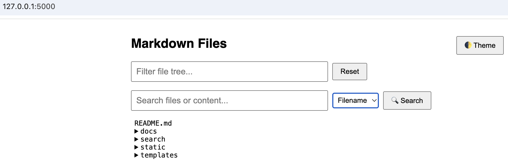
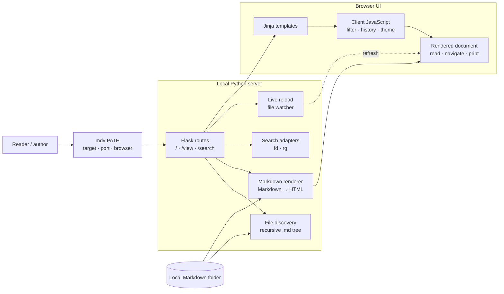
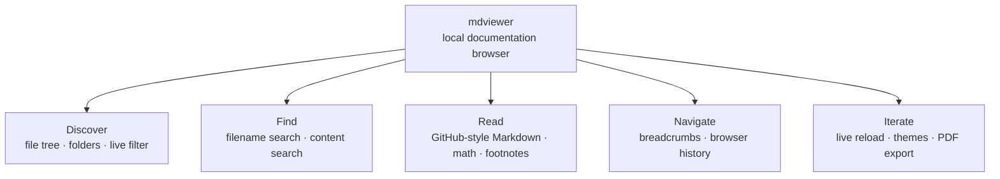

# 📝 Markdown Viewer (GitHub-Style)

[](https://pypi.org/project/mdviewer)
[](https://github.com/biaojiang/homebrew-mdviewer)
[](LICENSE)
[](https://pepy.tech/projects/mdviewer)

A GitHub-style Markdown viewer for local docs, with file tree, search, and live reload.

A local Markdown documentation browser that:

- Renders `.md` files with GitHub-flavored styles
- Displays a recursive file/folder tree
- Supports live plain-text filtering (client-side)
- Supports filename/content search with built-in Python search; optionally uses `fd`/`fdfind` or `rg` when installed
- Auto-reloads edited files
- Dark/light mode toggle
- Print or save to PDF through the browser
- Optional LaTeX PDF export add-on (requires the separate `md-to-lualatex` project)
- Breadcrumb navigation with folder/file icons
- Highlights current file in tree and auto-expands

## 🔍 Preview

`mdviewer` opens a clean, local browser UI to view Markdown files — with a collapsible file tree, file filtering, fuzzy search, and full-text content search built in.



## 🧭 Idea & Architecture

`mdviewer` turns a local folder of Markdown files into a browsable documentation
site with one command. The files remain the source of truth: the Python server
discovers and renders them, while the browser provides navigation, search, and
reading tools.





## 🚀 Installation

### 🔧 Option 1: Homebrew (macOS/Linux)

```bash
brew tap biaojiang/mdviewer
brew install biaojiang/mdviewer/mdviewer
```

### 🐍 Option 2: Python (via pip)

```
pip install mdviewer
```

Search works immediately with no extra tools. If `fd` (or Debian’s `fdfind`)
and `rg` are on PATH, mdviewer uses them automatically for faster searches.
Missing tools use the built-in Python backend; no binaries are downloaded.

### Optional: LaTeX PDF export

The **LaTeX PDF** button is an optional add-on in mdviewer 0.5.0. You can keep
using mdviewer and the regular browser print/export without installing Pandoc,
LaTeX, or the separate converter. When enabled, the button uses the
[`md-to-lualatex` project](https://github.com/biaojiang/md-to-lualatex) to
compile the current Markdown file.

To enable LaTeX export, clone or install `md-to-lualatex` on the machine
running mdviewer, and install its prerequisites: Pandoc and a LuaLaTeX toolchain
that provides `latexmk`. The project bundles its monochrome Noto Emoji font and
Pandoc emoji filter. Point mdviewer at the checkout by setting
`MDVIEWER_LATEX_REPO` before launching it. The default path is
`/Volumes/Work/repos/md-to-lualatex`.

For example, in zsh:

```bash
export MDVIEWER_LATEX_REPO="$HOME/path/to/md-to-lualatex"
mdviewer ~/Documents/notes
```


**Optionally add an alias:**

```bash
echo 'alias mdv="mdviewer"' >> ~/.zshrc
source ~/.zshrc
# or symlink
sudo ln -s $(which mdviewer) /usr/local/bin/mdv
```

### 🔧 Option 3: Build from Source

```sh
# Install Python deps
pip install -r requirements.txt

# Optional: use a venv
python -m venv .venv
source .venv/bin/activate

# Optional: install faster search tools
brew install fd ripgrep
# or
sudo apt install fd-find ripgrep

# ▶️ Run the Server
python app.py

Open [http://127.0.0.1:5000](http://127.0.0.1:5000/) in your browser.
```

---

## 🛠️ Usage
```bash
mdviewer [PATH] or mdv [PATH]

# e.g.:
mdv # serve the current directory and open the browser when Markdown is found
mdv .
mdv /path/to/README.md
mdv --no-open # serve without opening a browser
```

---

## 🚀 Features

- ✅ GitHub-style rendering via `markdown-it-py` + GitHub CSS
- ✅ Footnote references with links to definitions and return links
- ✅ Auto-expandable file tree using `<details>`
- ✅ Live filtering with reset button
- ✅ Backend-powered search:
	- filename regular-expression matching (smart case)
	- `rg`: content search
- ✅ Flask-based local webserver
- ✅ MathJax support for LaTeX
- ✅ Reload current buffer on changes (with `livereload`)
- ✅ Font Awesome icons for folders/files
- ✅ Breadcrumb that reflects navigation path
- ✅ Highlight + auto-expand tree for active file
- ✅ Browser print/export to PDF
- ✅ Optional LaTeX PDF export add-on via `md-to-lualatex` (see setup above)

---

## 📁 File Structure

```text
.
├── docs
│   └── math
│       └── math-test.md
├── pyproject.toml
├── README.md
├── requirements.txt
├── screenshot.png
└── src
    ├── mdviewer
    │   ├── __init__.py
    │   ├── app.py
    │   ├── cli.py
    │   ├── search
    │   │   ├── __init__.py
    │   │   ├── __pycache__
    │   │   ├── fd_search.py
    │   │   └── rg_search.py
    │   ├── static
    │   │   ├── script.js
    │   │   └── style.css
    │   └── templates
    │       ├── index.html
    │       ├── search.html
    │       └── viewer.html
    └── 
```

---

## 🔍 Search Modes

- filename regex search (smart case; optional `fd`/`fdfind` accelerator)
- `rg`: full-text content match (powerful)

---

## ⚙️ Keyboard & UI

- 🌓 Dark/light toggle
- ⌨️ Live tree filter with reset
- 🗂 Expandable nested folders
- 🔗 Click to render `.md` file in browser
- 🖨 Export/Print to PDF button
- 📁 Breadcrumb with Font Awesome icons
- 📄 Highlight + expand tree for active file

---

## ⏭️ Next Steps

-

---

## 📄 License

MIT

### Document safety

Raw HTML inside Markdown is displayed as text. Markdown formatting, tables,
footnotes, math, and images remain supported. Raw files such as HTML and SVG
are served with a browser sandbox that disables scripts and same-origin access;
SVG diagrams can still be embedded as images.

Files and folders reached through symlinks inside the served tree are not served
or listed. The folder explicitly selected on the command line may itself be a
symlink. This keeps document reads inside the selected folder even when a file
is replaced while a request is being handled.

### Search backends

Filename searches use regular expressions with smart case: lowercase patterns
ignore case; patterns containing uppercase letters are case-sensitive. Content
searches are case-insensitive and match individual lines. Queries beginning with
`-` remain search patterns.

The Python fallback searches `.md` files, skips hidden entries and the viewer's
excluded directories, and never follows descendant symlinks. It uses Python-compatible
regular-expression syntax through the automatically installed `regex` package.
Patterns are limited to 4,096 characters; matches have a 0.1-second timeout and
the fallback has a five-second search budget. Invalid or timed-out searches
return no results. The optional external tools use their own regex
engines, ignore-file rules, and Markdown file-type definitions, so advanced
patterns and file selection can differ. The fallback does not interpret
`.gitignore` files.
